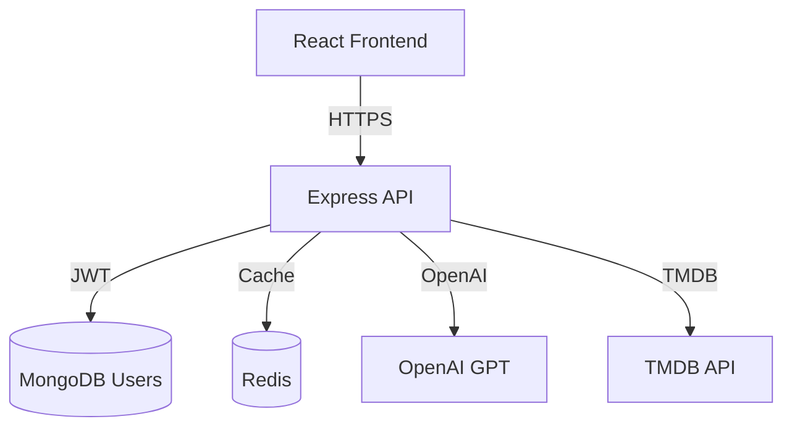

# Netflix GPT

AI-powered Netflix-style movie discovery platform with natural-language search, personalized recommendations, and a production-grade Node/Express backend.

[](https://your-live-link.com)
[](https://github.com/yourusername/netflix-gpt)
[](LICENSE)

## Demo


## Architecture



## Features

- **Authentication** — Signup, signin, JWT sessions, bcrypt password hashing, rate-limited auth endpoints
- **Movie browsing** — Now Playing, Popular, and Trending movies with trailers and details
- **AI search** — Natural-language queries via OpenAI GPT, with TMDB metadata enrichment
- **Watchlist** — Add/remove saved movies with optimistic UI and duplicate prevention
- **Recommendations** — AI suggestions with graceful fallback to TMDB trending when OpenAI is unavailable
- **Server-side TMDB proxy** — API key never exposed to the browser
- **Multi-language** — i18n with language switcher
- **Responsive UI** — Tailwind CSS, Netflix-style layout

## Tech Stack

**Frontend:** React 18, Redux Toolkit, React Router, Tailwind CSS  
**Backend:** Node.js, Express, Mongoose, Zod, Pino  
**Infrastructure:** Docker, Redis, MongoDB Atlas, GitHub Actions  
**AI / APIs:** OpenAI GPT, TMDB

## Quick Start

### Option 1: Docker (recommended)

```bash
git clone https://github.com/yourusername/netflix-gpt.git
cd netflix-gpt
cp server/.env.example server/.env
# edit server/.env with your values
docker compose up --build
```

- App: http://localhost:3000
- API health: http://localhost:5000/api/health

### Option 2: Local development

```bash
# Install dependencies
npm.cmd --prefix client install
npm.cmd --prefix server install

# Configure environment variables
# Create server/.env (see server/.env.example)
# Create client/.env (see client/.env.example)

# Run both servers
npm.cmd run dev
```

## API Endpoints

| Method | Endpoint | Description |
|--------|----------|-------------|
| POST | `/api/v1/auth/signup` | Create account |
| POST | `/api/v1/auth/signin` | Sign in |
| GET | `/api/v1/auth/me` | Get current user |
| GET | `/api/v1/watchlist` | List saved movies |
| POST | `/api/v1/watchlist` | Save a movie |
| DELETE | `/api/v1/watchlist/:movieId` | Remove a movie |
| POST | `/api/v1/recommendations` | AI movie recommendations |
| GET | `/api/v1/health` | Health check |

Swagger UI: `/api-docs` (when running locally)

## Roadmap

See [`PROJECT_ROADMAP.md`](PROJECT_ROADMAP.md) for the phased senior-engineering roadmap covering backend hardening, Docker/CI, UX polish, AI resilience, and LinkedIn/GitHub positioning.

## License

MIT

